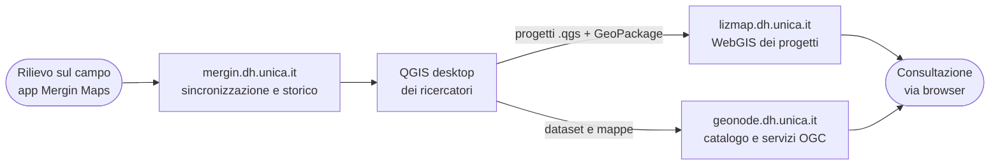
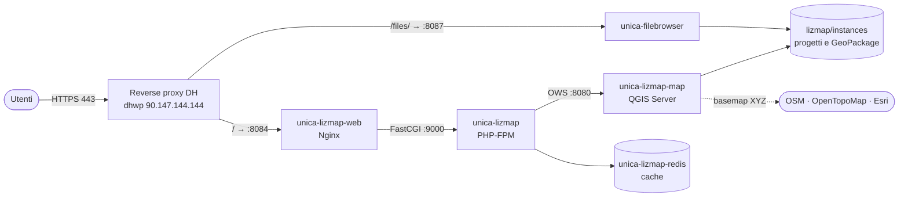

<div align="center">

# 🗺️ Lizmap DH UNICA

**Il WebGIS dei progetti di ricerca del Centro Interdipartimentale per l'Umanistica Digitale dell'Università di Cagliari**

[](https://lizmap.dh.unica.it/)
[](https://www.lizmap.com/)
[](https://qgis.org/)
[](docker-compose.yml)
[](https://dh.unica.it/)

</div>

---

## Cos'è

**[lizmap.dh.unica.it](https://lizmap.dh.unica.it/)** pubblica sul web i progetti QGIS dei gruppi di ricerca del Centro. Chi prepara una mappa in QGIS desktop la carica sul server e la ritrova come WebGIS consultabile dal browser, con legenda, popup, ricerca, stampa ed esportazione dei dati, senza scrivere codice.

Si appoggia su [Lizmap Web Client](https://www.lizmap.com/) di 3Liz e su [QGIS Server](https://qgis.org/): la mappa web è disegnata dallo stesso motore e con gli stessi stili del progetto desktop.

Il primo progetto ospitato è **PARC WebGis** (*Prosopography of Africa's Roman Cities*), con referente Antonio M. Corda. Fino a ottobre 2026 era pubblicato da Faunalia su `webparc.it`; da novembre 2026 gira sui server del Centro (vedi [docs/MIGRAZIONE.md](docs/MIGRAZIONE.md)).

Questo repository contiene **la configurazione di produzione** dello stack e gli strumenti per ripristinarlo, verificarlo e salvarlo. I progetti QGIS, i dati e gli utenti stanno solo sul server e nei backup.

### Cosa ci si trova

**PARC WebGis** raccoglie i dati del progetto sulle città romane d'Africa:

- 🏛️ siti del progetto e tabella dei siti, con i riferimenti a [Pleiades](https://pleiades.stoa.org/) per il Nord Africa;
- 👤 schede prosopografiche e schede delle fonti;
- ✝️ diocesi africane e loro denominazioni;
- 🧭 viabilità romana dell'*Africa* e della *Sardinia* e viabilità di età araba;
- 📜 iscrizioni dall'[EDCS](https://db.edcs.eu/) (Epigraphik-Datenbank Clauss/Slaby);
- 🗺️ confini moderni e della Sardegna, su basemap OpenStreetMap, OpenTopoMap ed Esri.

L'accesso è **riservato agli utenti registrati**, come richiesto da Antonio M. Corda per i primi mesi di lavoro.

---

## Parte dell'ecosistema DH UNICA

[DH UNICA](https://dh.unica.it/) è il **Centro Interdipartimentale per l'Umanistica Digitale** dell'Università di Cagliari. Sviluppa soluzioni tecnologiche per la ricerca umanistica, crea fonti digitali, forma studenti e ricercatori e produce risorse aperte e riutilizzabili.

Per i dati spaziali il Centro usa tre strumenti complementari:



- **[Mergin Maps](https://github.com/Dh-unica/mergin.dh.unica.it)** raccoglie i dati sul campo;
- **Lizmap** pubblica i progetti QGIS così come sono stati disegnati;
- **[GeoNode](https://github.com/Dh-unica/geonode.dh.unica.it)** cataloga e distribuisce i dataset con metadati standard.

Mergin e Lizmap non si sincronizzano tra loro: i dati passano dal QGIS dei ricercatori.

---

## 🧰 Stack tecnologico

| Componente | Immagine / versione | Ruolo |
|---|---|---|
| **Lizmap Web Client** | `3liz/lizmap-web-client:3.9.11` | Applicazione web (PHP-FPM): utenti, permessi, interfaccia della mappa |
| **QGIS Server** | `3liz/qgis-map-server:3.44` | Disegna le mappe e serve WMS, WFS e WMTS; plugin `lizmap_server` e `wfsOutputExtension` |
| **Nginx** | `nginx:1.27-alpine` | File statici e passaggio a PHP-FPM; è il punto d'ingresso dello stack |
| **Redis** | `redis:5-alpine` | Cache delle tessere della mappa |
| **Filebrowser Quantum** | `ghcr.io/gtsteffaniak/filebrowser:2-stable-slim` | Caricamento e scaricamento dei progetti da browser, su `/files/` |

---

## 🏗️ Architettura



Lo stack gira su **dhgeo** (`90.147.144.148`), la VM GIS del Centro, insieme a Mergin Maps. Il TLS si ferma sul reverse proxy comune [`proxy.dh.unica`](https://github.com/caprowsky/proxy.dh.unica), con il certificato wildcard `*.dh.unica.it`. Le porte 8084 e 8087 di dhgeo accettano connessioni solo dal proxy e dalla VPN d'ateneo.

I progetti usano solo GeoPackage con percorsi relativi, quindi non c'è un database geografico: basta la cartella `lizmap/instances`. Utenti, gruppi e permessi stanno in SQLite (`lizmap/var/lizmap-db/jauth.db`).

---

## 📁 Struttura del repository

```text
lizmap.dh.unica.it/
├── README.md                 ← questo file
├── CLAUDE.md                 ← istruzioni e regole per le sessioni di Claude Code
├── PROSSIMI-PASSI.md         ← stato attuale e attività da fare, aggiornato a ogni intervento
├── docker-compose.yml        ← definizione dei servizi
├── .env.example              ← porte pubblicate sull'host (copiare in .env)
├── docs/
│   └── MIGRAZIONE.md         ← migrazione dal server Faunalia a dhgeo: problemi trovati, procedura, verifiche
├── scripts/
│   ├── ripristina-export.sh  ← ripristino di dati e stato dall'export Faunalia
│   ├── smoke-test.sh         ← controlli rapidi dello stack (solo letture)
│   └── backup.sh             ← backup di progetti, configurazione, utenti e Filebrowser
├── lizmap/etc/               ← configurazione drop-in montata in sola lettura (nginx, Lizmap, QGIS)
├── filebrowser_quantum/
│   └── config.yaml           ← configurazione di Filebrowser
└── .githooks/pre-commit      ← blocca i commit su main e l'ingresso di segreti o dati
```

Sul server, accanto ai file versionati, ci sono le cartelle escluse da git: `lizmap/instances` (progetti), `lizmap/var` (configurazione scritta dall'interfaccia di amministrazione, utenti, log), `lizmap/www` (asset generati dal container), `lizmap/qgis-plugins`, `lizmap/qgis-authdb` e il database di Filebrowser.

---

## ⚙️ Configurazione

| Dove | Cosa | Versionato |
|---|---|---|
| `.env` | porte pubblicate: `LIZMAP_WEB_PORT`, `FILEBROWSER_PORT` | no, modello in [`.env.example`](.env.example) |
| `lizmap/etc/` | drop-in di Lizmap, `nginx.conf`, opzioni di QGIS | sì |
| `lizmap/var/lizmap-config/` | `lizmapConfig.ini.php` (repository, tema, servizi) e `localconfig.ini.php` | no: li modifica l'interfaccia di amministrazione, sono nel backup |
| `filebrowser_quantum/config.yaml` | percorso `/files/` e URL esterno | sì |

Il repository Lizmap configurato è uno: `parcwebgis`, cartella `PARC webGIS/`, visibile ai soli gruppi `admins` e `users`. La cartella `PARC_RC01/` è un'area di lavoro raggiungibile da Filebrowser, non pubblicata.

---

## 🚀 Gestione in produzione

Lo stack gira in `/home/dhgeo/lizmap.dh.unica.it` su dhgeo, con Docker Compose v2.

```bash
ssh -o IdentitiesOnly=yes -i ~/.ssh/id_rsa dhgeo@90.147.144.148
cd ~/lizmap.dh.unica.it
docker compose ps                         # stato dei servizi
docker compose logs -f --tail=100 lizmap map
scripts/smoke-test.sh                     # controlli rapidi
scripts/backup.sh                         # backup in ./backup
```

**Pubblicare o aggiornare un progetto:** si caricano il `.qgs`, il `.qgs.cfg` generato dal plugin Lizmap di QGIS e i GeoPackage nella cartella del repository, da `https://lizmap.dh.unica.it/files/` oppure via SFTP come utente `dhgeo` (uid 1000, lo stesso dei container). I progetti vanno salvati con QGIS 3.44, la versione del server.

> [!WARNING]
> Da **non** usare: `docker compose down -v`, `docker system prune`, `rm` su `lizmap/instances` o `lizmap/var`. Prima di aggiornare le immagini, fare un backup con `scripts/backup.sh`.

---

## 🤝 Come contribuire

- **Mai commit diretti su `main`**: `main` rispecchia ciò che gira in produzione.
- Un branch per attività, creato da `main` aggiornato, con prefisso convenzionale: `feat/`, `fix/`, `docs/`, `chore/`, `refactor/`.
- Messaggi di commit **in italiano** con tipo convenzionale, per esempio `fix: alias di rete per la cache Redis`.
- Ogni branch si chiude con una Pull Request; dopo il merge il branch si cancella (impostazione automatica del repository).
- I rilasci in produzione hanno un tag `prod-<data>`, per esempio `prod-2026-11-02`.
- Dopo il clone, attivare i controlli locali: `git config core.hooksPath .githooks`. L'hook blocca i commit su `main` e l'ingresso di `.env`, dump, database e archivi.
- Su GitHub il workflow [Regole del workflow](.github/workflows/regole-git.yml) controlla ogni PR (prefisso del branch, file vietati) e segnala in rosso i push su `main` che non arrivano da una PR. L'organizzazione è sul piano Free, che per i repository privati non offre la protezione dei branch: il blocco vero è l'hook locale.
- Sul server il repository si aggiorna solo con `git pull` da `main`: lì non si fanno commit.

---

<div align="center">
<sub>
<a href="https://dh.unica.it/">DH UNICA</a>, Centro Interdipartimentale per l'Umanistica Digitale · Università degli Studi di Cagliari<br/>
Basato su <a href="https://www.lizmap.com/">Lizmap</a> di 3Liz e su <a href="https://qgis.org/">QGIS Server</a>, software open source
</sub>
</div>
